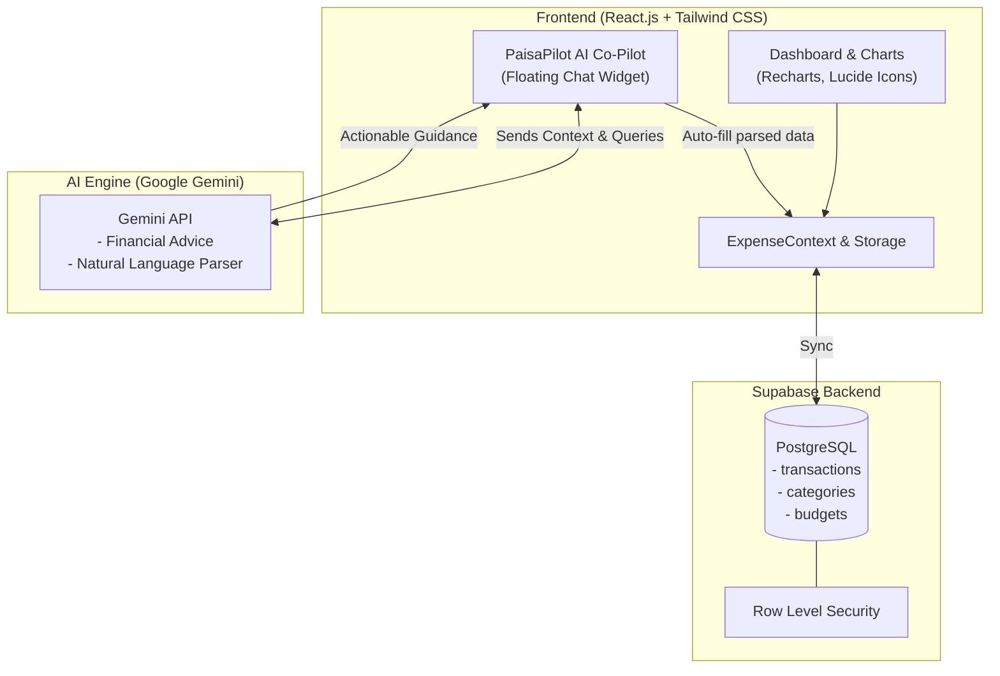

# 🚀 PaisaPilot — Personal AI Expense Guide & Tracker

A modern, fast personal expense tracker web app built with **React.js (JavaScript)**, **Tailwind CSS**, **Supabase (PostgreSQL)**, and an **Embedded AI Financial Co-Pilot (Google Gemini)** tailored for Indian expenses (`₹ INR`).

---

## ✨ Features

- ⚡ **Ultra-Fast Quick Add**:
  - **AI Natural Language Parsing**: Type e.g., *"Dinner with friends at Social 1450 via UPI"* or *"Paid 1800 for petrol using card"*, and the AI auto-fills Amount, Category, Payment Mode, and Notes!
  - **Manual Entry**: Quick hotkey (Press `N` anywhere), category pickers, and payment modes (UPI, Credit Card, Debit Card, Cash, Net Banking).
- 🤖 **Embedded AI Financial Guide (PaisaPilot AI)**:
  - Accessible via the floating pill in the bottom-right corner.
  - Ask realistic questions: *"Can I afford a ₹5,000 smart watch this week?"*, *"Where did most of my money go?"*, or *"Give me 3 tips to save ₹5,000"*.
  - Grounded directly in your real-time monthly numbers, savings rate, and category breakdowns.
- 📊 **Visual Analytics (Recharts)**:
  - Donut chart showing spending distribution by category.
  - Payment mode split (UPI vs Cards vs Cash).
  - Progress bars against monthly budgets with instant over-budget alerts.
- 🎯 **Category Budgets**:
  - Set custom spending limits for Food, Groceries, Shopping, Entertainment, etc.
- 📋 **Interactive Transaction Ledger**:
  - Search by keyword or description.
  - Filter by Category, Payment Mode, and Income/Expense.
  - One-click CSV Export.
- ☁️ **Dual Storage Support**:
  - **Instant Offline / Local Mode**: Works immediately out-of-the-box with localStorage.
  - **Supabase Cloud Sync**: Connect your Supabase project in Settings for multi-device sync.

---

## 🏗️ Working Architecture



---

## 🛠️ Getting Started

### 1. Install & Run Locally
```bash
npm install
npm run dev
```
Open [http://localhost:5173](http://localhost:5173) in your browser.

### 2. Connect Supabase (Optional)
1. Go to [supabase.com](https://supabase.com) and create a free project.
2. In the **SQL Editor**, paste and run the contents of [`supabase_schema.sql`](file:///d:/Coding/Projects/ExpenseTracker/supabase_schema.sql).
3. In the PaisaPilot web app, click **Settings (⚙️)** in the top right and enter your:
   - **Supabase URL**
   - **Supabase Anon Key**
4. Click **Save & Connect**. Your expenses will now sync to PostgreSQL in real time!

### 3. Connect Google Gemini API (Optional)
1. Get a free API key from [Google AI Studio](https://aistudio.google.com/app/apikey).
2. Enter your key in **Settings (⚙️)** or inside `.env.local` as `VITE_GEMINI_API_KEY`.
*(If left empty, PaisaPilot uses its built-in offline financial reasoning engine!)*

---

## 📁 Project Structure

```text
ExpenseTracker/
├── index.html
├── vite.config.js
├── tailwind.config.js
├── supabase_schema.sql          # Ready-to-run Supabase migration
├── .env.example
├── src/
│   ├── main.jsx                 # Entry point
│   ├── App.jsx                  # Main dashboard layout & shortcuts
│   ├── index.css                # Tailwind base styles
│   ├── api/
│   │   ├── supabase.js          # Supabase client & fallback logic
│   │   └── gemini.js            # Gemini AI Advisor & Natural Text Parser
│   ├── components/
│   │   ├── common/
│   │   │   ├── Navbar.jsx       # Header, Month selector, Settings
│   │   │   ├── CategoryIcon.jsx # Dynamic Lucide icons & payment tags
│   │   │   └── SettingsModal.jsx# Supabase & Gemini key configuration
│   │   ├── dashboard/
│   │   │   ├── SummaryCards.jsx # Net Balance, Expense, Income, Savings Rate
│   │   │   ├── SpendingCharts.jsx# Donut & Payment mode charts
│   │   │   └── SmartBudgetAlert.jsx # Proactive AI insights banner
│   │   ├── transactions/
│   │   │   ├── AddTransactionModal.jsx # AI Auto-Fill & Manual form
│   │   │   └── TransactionList.jsx     # Searchable ledger & CSV export
│   │   ├── budget/
│   │   │   └── BudgetManagerModal.jsx  # Monthly limit manager
│   │   └── ai-advisor/
│   │       └── AiAdvisorWidget.jsx     # Floating chat assistant
│   ├── context/
│   │   └── ExpenseContext.jsx   # Global financial state & metrics
│   └── utils/
│       ├── formatters.js        # Indian Rupee (₹) & date formatting
│       └── initialData.js       # Pre-loaded demo transactions
```
